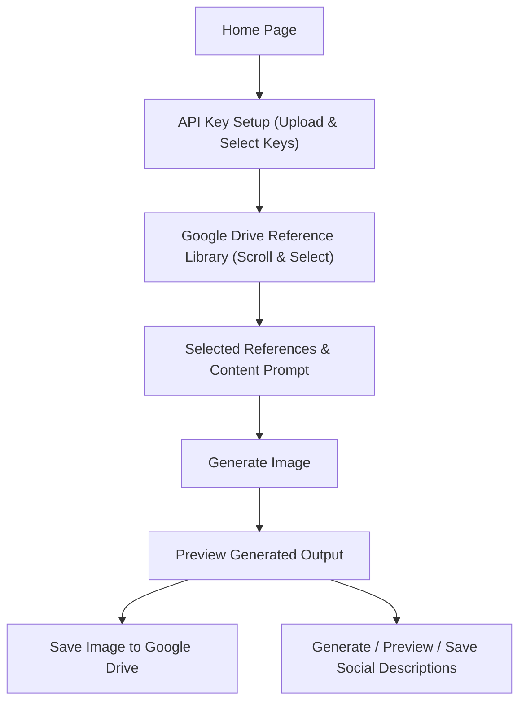

# Agentic Content Generator (Image Generator UI)

An AI-powered image generation and social-media content workspace that uses numbered **Google Drive** reference images, multi-provider AI API keys, AI image tagging, prompt-driven image synthesis, and Google Drive output storage.

---

## Key Features

### 1. Multi-Provider AI API Key Management (`/api-setup`)
- Upload an API key configuration file (`.env`, `.txt`, or `.json`).
- Supports multiple API keys across providers (e.g., **Gemini**, **OpenRouter**, **Claude**) and lets you select multiple keys simultaneously.
- Selected API keys are highlighted in the UI and can be changed from the Image Generator header without restarting.
- The backend automatically routes tasks (vision/tagging, image generation, social-media descriptions) to compatible selected providers.

### 2. Google Drive Reference Library
- Loads reference images directly from the configured Google Drive reference folder (`GOOGLE_DRIVE_FOLDER_ID`).
- Displays a numbered, scrollable reference library with large thumbnails so you can visually browse and select one or more references.
- Automatically analyzes and tags reference images with AI (`image_tagger.py`).

### 3. Selected References & Content Prompt
- Displays the selected Google Drive reference images with their highlighted reference numbers.
- Lets you write a `Content Prompt` referencing those numbers directly (e.g., *"Use 1 for the layout, 3 for the logo, and 5 for the color style"*).

### 4. Image Generation & Generated Output
- Synthesizes a new coherent image from the selected reference(s) and prompt using an image-capable AI provider.
- Displays a large, clean output preview alongside generation metadata (output filename, API provider, and model).
- **Save to Google Drive**: Saves the generated image into the configured Google Drive output folder (`GOOGLE_DRIVE_OUTPUT_FOLDER_ID`).
- **Social Media Description**: Generates platform-specific social media descriptions and hashtags from the generated image, with preview and save-to-Drive support.

---

## Workflow



---

## Project Structure

```text
Image_generator_UI/
├── backend/
│   ├── app/
│   │   ├── main.py                  # FastAPI server, API key routing, Drive & generation endpoints
│   │   └── services/
│   │       ├── image_tagger.py      # AI-based reference image tagging
│   │       ├── prompt_generator.py  # Prompt helper utilities
│   │       ├── template_builder.py  # Structured template builder utilities
│   │       └── template_generator.py
│   ├── list_drive_folders.py        # Helper to list Google Drive folders
│   ├── reauth_drive.py              # Helper to re-authenticate Google Drive OAuth
│   ├── requirements.txt
│   └── requirements-railway.txt
├── frontend/
│   ├── src/
│   │   ├── components/
│   │   │   ├── ApiKeySetup.tsx      # API key file upload & provider selection page
│   │   │   ├── ApiServiceIcon.tsx   # Provider icon registry
│   │   │   └── HomePage.tsx         # Landing page & Content Generator placeholder
│   │   ├── services/
│   │   │   └── templateService.ts   # Template API client & types
│   │   ├── types/
│   │   │   └── app.ts               # Shared TypeScript interfaces
│   │   ├── utils/
│   │   │   └── appHelpers.ts        # URL, hashtag, and session persistence helpers
│   │   ├── App.tsx                  # Main Image Generator workspace & router
│   │   ├── App.css                  # Application styling
│   │   └── main.tsx
│   ├── package.json
│   └── vite.config.ts
└── README.md
```

---

## Environment & Google Drive Configuration

Create `backend/.env` (never commit real keys or OAuth files):

```env
GEMINI_API_KEY_1=your-key
OPENROUTER_API_KEY_1=your-key
CLAUDE_API_KEY_1=your-key

GOOGLE_DRIVE_FOLDER_ID=your-reference-folder-id
GOOGLE_DRIVE_OUTPUT_FOLDER_ID=your-output-folder-id
```

Google Drive OAuth uses `backend/credentials.json` and `backend/token.json` locally (or Base64 environment variables `GOOGLE_DRIVE_CREDENTIALS_JSON_B64` and `GOOGLE_DRIVE_TOKEN_JSON_B64` for Railway deployments).

---

## Running Locally

### 1. Start the Backend (FastAPI)

```powershell
cd backend
python -m venv .venv
.\.venv\Scripts\Activate.ps1
pip install -r requirements.txt
uvicorn app.main:app --reload --port 8000
```

Backend URL: `http://localhost:8000`

### 2. Start the Frontend (React + Vite)

In a second terminal:

```powershell
cd frontend
npm install
npm run dev
```

Frontend URL: `http://localhost:5173`
